<p align="center">
  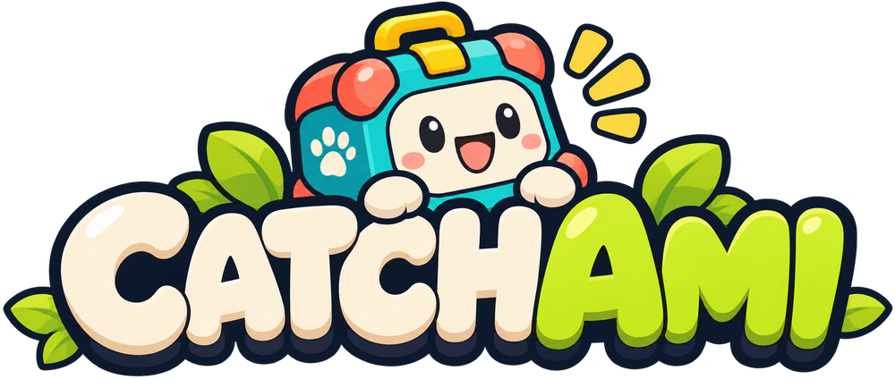
</p>

<h3 align="center">Catch real animals. Build their virtual lives.</h3>

<p align="center">
A mobile-first multiplayer fantasy game where real-world cats and dogs become playable NFTs with their own wallets, earning and spending in a living, self-regulating economy.
</p>

<p align="center">
  <a href="https://catchami.fun/"><b>▶ Play Catchami</b></a> ·
  <a href="https://github.com/jjlimkamsahmida-coder/catchami">GitHub</a> ·
  <a href="https://x.com/catchamifun/status/2121735385323868477"><b>Demo video</b></a>
</p>

<p align="center">
  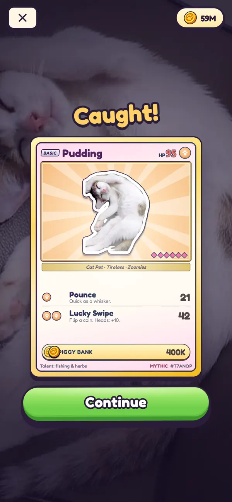
  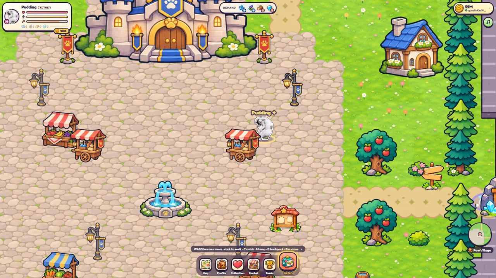
</p>

---

## The problem

- **Earning that isn't tied to anything.** Many token games pay rewards that have little connection to real spending, real demand or the reserves that fund them, so payouts outrun the economy behind them.
- **NFTs that just sit there.** Most collectibles do nothing beyond being owned and traded.
- **Static economies.** Fixed reward rates and NPCs with unlimited money produce markets that ignore supply, consumption and scarcity.
- **Hard onboarding.** Wallet setup, buying tokens and a signature for every action push mainstream players away.
- **Farming over fun.** When the reward is the point, the game stops being one.

## The solution

Catchami turns **your own cat or dog** into a game character, and gives that character a job, needs and a wallet.

- **Real-world capture:** point your phone at a real animal, throw a CamiCube, and it becomes a unique pet NFT.
- **Every pet has its own wallet:** its coins live with the NFT and move with it if it's sold.
- **A working life:** pets gather resources, sell them to travelling merchants, buy food and medicine, craft gear, battle in Bubble Roulette and trade on the marketplace.
- **Autopilot:** pets keep working on their owner's strategy while the owner is away.
- **A treasury with rules:** merchants are funded by an HQ treasury whose daily budget follows its reserves and real player spending, and prices follow recorded supply and demand.

Each piece feeds the others. Pets need coins to eat, so they work; their work becomes the food other pets eat, and that consumption sets what merchants pay.

---

## How it works

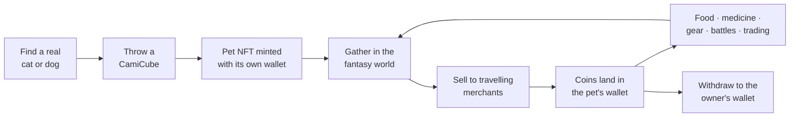

1. **Catch:** find a real cat or dog and throw a CamiCube (1M, 3M or 8M coins, with 60%, 80% or 100% catch chance). The server verifies a live animal before anything is charged.
2. **Own:** a successful catch mints a NEP-171 NFT. 40% of the cube price becomes the pet's starting balance.
3. **Work:** gather wood, herbs, fish and stone through four timing minigames, then sell to a merchant.
4. **Live:** pay for meals and medicine, craft gear, battle other pets, buy and sell on the marketplace.
5. **Automate:** set an Autopilot strategy and the pet runs its own routine.
6. **Withdraw:** move coins from the pet to your own wallet whenever you like.

<p align="center">
  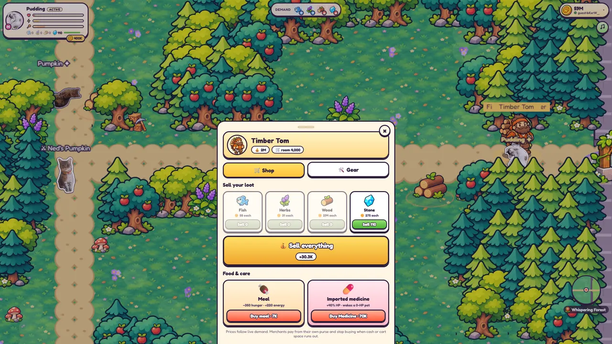
  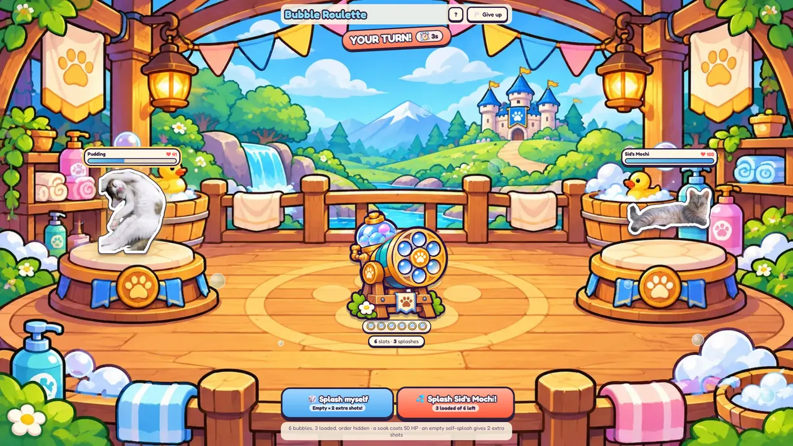
</p>

---

## Every NFT has its own wallet

This is what makes a Catchami pet more than a picture.

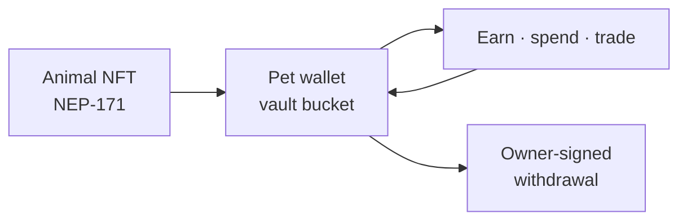

- **The pet:** each pet is a **NEP-171 NFT** on the game contract.
- **Its balance:** each pet has its own balance of **$CATCHAMI** (a NEP-141 token), held in a dedicated **vault bucket** inside the game contract: `Pet(<token id>)`.
- **Gameplay credits and debits it:** sales add coins, while meals, medicine and gear subtract them. Owners can top it up or move coins out.
- **The balance follows the NFT:** sell the pet and its savings go with it. Whoever owns the NFT owns its coins.
- **Smooth play:** every action is recorded instantly in a server-side double-entry ledger, and the net result settles on NEAR in batches, so play never stops for a signature.

<p align="center">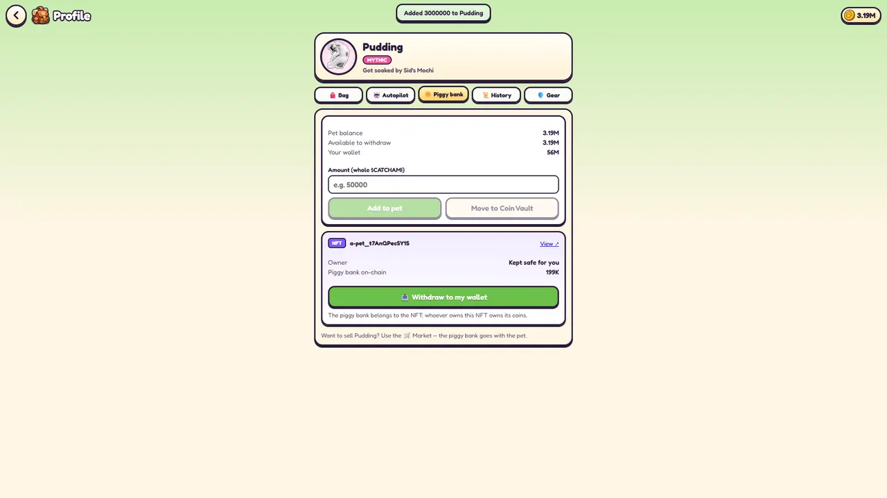</p>

---

## The living economy

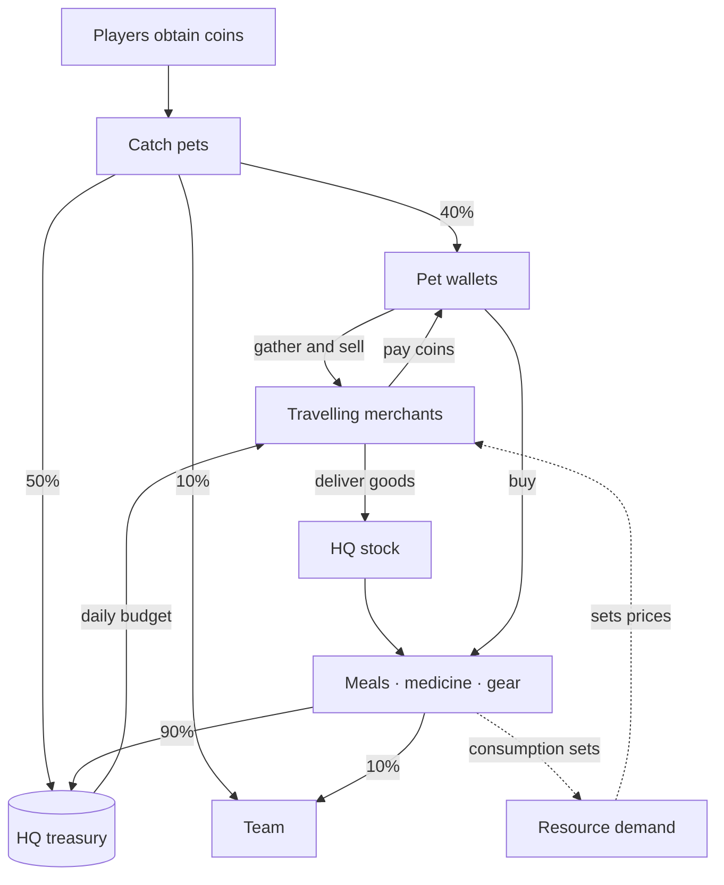

1. Players obtain $CATCHAMI and spend it catching pets: 40% to the pet, 50% to HQ, 10% to the team.
2. HQ funds travelling merchants each day, within a budget based on its reserves and recent revenue.
3. Pets gather and sell to merchants, and coins arrive in the pets' wallets.
4. Pets buy meals, medicine and gear. 90% returns to HQ and 10% goes to the team.
5. What merchants bought becomes HQ's stock: fish becomes meals, herbs become medicine, and wood and stone become gear.
6. Consumption changes demand, demand changes prices, and HQ recalculates tomorrow's budget.

Marketplace sales and battle spoils move coins **between players**, so that activity needs no HQ funding.

### Supply and demand

Prices come from real, recorded game activity, not from a decorative indicator:

- **More pets eating** → more fish consumed → fish pays more → more pets go fishing.
- **More battles** → more medicine → more herbs consumed → herbs pay more.
- **More crafting** → more wood and stone used → crafting materials pay more.

Each resource's index moves toward *(consumption + 4) / (supply + 4)*, by at most 2.5 points a minute, within 60%–175%. Each merchant also has favourite and disliked resources, a limited purse (0.2M–2M per trip) and a cart that holds 4,000 weight, and resource spots regrow at fixed rates.

### A treasury designed for discipline

- **Fixed supply:** 100T $CATCHAMI, minted once, with no mint function.
- **Recycling:** catches, upkeep, crafting and fees flow back into HQ.
- **A budget, not a tap:** `min(0.01% × spendable + 60% × 7-day average revenue, 0.03% × spendable)`, about **3.8B coins a day** today.
- **A protected reserve:** HQ can never spend below its 2T floor, and prices taper as it approaches.
- **An on-chain hard cap:** the contract won't let settlement debit HQ by more than 20B a day.
- **Limited merchants:** merchants can't buy without coins, beyond their cart, or beyond the day's budget.

The economy adapts: when players spend more, merchants can buy more; when activity slows, payouts shrink with it. Full model and formulas: **[docs/ECONOMY.md](docs/ECONOMY.md)**.

---

## Revenue model

| Activity | Pet keeps | HQ | Team |
|---|---:|---:|---:|
| Successful catch (1M / 3M / 8M) | 40% | 50% | **10%** |
| Failed catch (a valid animal escaped) | — | 100% | — |
| Invalid capture | nothing charged | | |
| Meal (7K) · medicine (35K) · crafting (40K–90K) | — | 90% | **10%** |
| Marketplace sale (5% fee) | seller gets 95% | 2.5% | **2.5%** |
| Bubble Roulette between players (10% of coins taken) | winner gets 90% | 9% | **1%** |
| Coin purchases from the 55T market allocation | — | — | primary sale proceeds |

Three things to keep apart:
1. **HQ's share recirculates:** it funds the merchants that pay players. It isn't profit.
2. **The team share is recurring in-game revenue,** paid in coins as people play.
3. **Coin purchases** are the external, fiat or crypto revenue. On testnet, the payment step is simulated and the coin delivery is real.

The team's 5T token allocation is a founding allocation, separate from these fees. Details: **[docs/BUSINESS_MODEL.md](docs/BUSINESS_MODEL.md)**.

---

## Web2-friendly by design

- **One-tap start:** guest access, or Continue with Google.
- **NEAR Auth:** Google, email or passkey sign-in that creates a real NEAR account with no seed phrase. It's implemented, and runs on domains NEAR has approved; approval for catchami.fun is pending.
- **NEAR wallets:** Meteor, Intear, HERE and Sender sign in with a gas-free signed message.
- **Coins, not tokens:** balances read like any game currency.
- **No pop-ups while playing:** gathering, selling, eating and crafting never ask for a signature. The game pays for minting and settlement.
- **Mobile-first:** a phone camera for catching, a joystick, big buttons. It also works on PC.

### Buy → earn → withdraw → swap → cash out

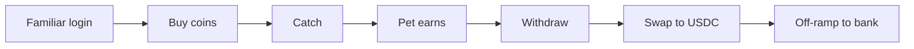

| Step | Status on testnet |
|---|---|
| Buy coins by card or any crypto (NEAR Intents) | Coins delivered on-chain; payment step simulated |
| Withdraw from a pet to your wallet | ✅ Live, signed by the player |
| Swap $CATCHAMI → USDC | ✅ Live on Ref Finance pool #2969 (test USDC) |
| Cash out to a bank | Planned via a licensed off-ramp provider; simulated interface today |

More: **[docs/WEB2_ONBOARDING_AND_PAYMENTS.md](docs/WEB2_ONBOARDING_AND_PAYMENTS.md)**.

---

## Autonomous pets

Autopilot is always on. Whenever the owner isn't steering, the pet decides for itself, in this order:

1. **0 HP:** walk to the nearest merchant and buy medicine.
2. **Hungry:** buy a meal (imported if the kitchen is out of fish).
3. **Hurt (below 30% HP):** buy medicine.
4. **Tired:** nap until energy recovers.
5. **Otherwise:** gather the chosen resource, or whichever is in highest demand, and sell according to the owner's rule (often, when full, best-paying merchant, nearest merchant, or hold).

It's a deterministic strategy engine using only information the pet could know: its own state, public merchant positions and published demand. Autopilot never starts a battle.

<p align="center">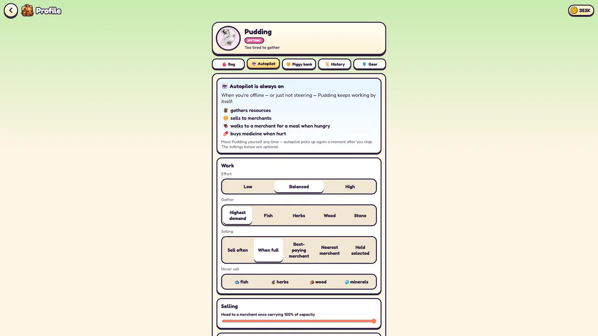</p>

---

## On-chain architecture

| Piece | What NEAR provides in Catchami |
|---|---|
| **$CATCHAMI (NEP-141)** | A fixed 100T supply, transferable to any NEAR account and tradable on Ref Finance |
| **Pet and gear NFTs (NEP-171)** | Real, transferable ownership of every caught animal and crafted item |
| **Vault buckets** | One balance per pet, per player, plus HQ, merchants and team, inside the game contract |
| **Batched settlement** | The ledger's net changes are applied every ~30 seconds. Batches must sum to zero and be numbered in sequence, and HQ, pet and team limits are enforced by the contract |
| **Withdrawals** | Player-signed request and execute, with a 24-hour escape hatch if the server doesn't respond |
| **Commit-reveal randomness** | Every catch, rarity, battle and gear roll is `HMAC(seed, label)`. The seed's hash is published first and the seed is revealed after |

| Contract (NEAR testnet) | Account |
|---|---|
| $CATCHAMI token | [`token.catchami-dev.testnet`](https://testnet.nearblocks.io/address/token.catchami-dev.testnet) |
| Game: NFTs, vault, settlement | [`game.catchami-dev.testnet`](https://testnet.nearblocks.io/address/game.catchami-dev.testnet) |

Verified mint, settlement, withdrawal and swap transactions: **[docs/ONCHAIN_VERIFICATION.md](docs/ONCHAIN_VERIFICATION.md)**.

---

## By the numbers

| | |
|---|---|
| Token supply | 100T fixed, split 40% HQ / 55% market / 5% team |
| Deployed contracts | 2 (token + game), plus a live $CATCHAMI/USDC pool |
| World | 3 areas plus a tutorial glade, 4 travelling merchants, 4 resources, 4 gathering minigames, Bubble Roulette |
| Settlement | Every ~30 s, or on demand ("Sync now") |
| Tests | 49 passing (shared rules, server, minigames) |
| Simulation | 5 scenarios, 100 → 10,000 starting pets, 30 days each, **0 accounting invariant violations** |
| Simulated health | 250 pets per world kept 92–98% of pets active; HQ ended every scenario above its starting balance |

*Simulation figures are model outputs, not real users.* See **[docs/ECONOMY_SIMULATION.md](docs/ECONOMY_SIMULATION.md)**.

---

## Tech stack

- **Client:** React 19 + Phaser 3, Vite, mobile-first.
- **Server:** Node 22 + TypeScript. Authoritative world simulation at 10 Hz over WebSockets, autopilot, merchants, demand engine, on-server animal detection.
- **Shared rules:** one versioned economy config used by the client, server and simulator.
- **Money:** a double-entry ledger on PostgreSQL (PGlite locally), with database-enforced invariants and reconciliation every 5 minutes.
- **Contracts:** Rust (near-sdk 5), for the token plus the NFT/vault/settlement game contract.
- **Chain worker:** handles minting, custody, deposit and withdrawal indexing, and batched settlement.

## Quick start

```bash
pnpm install
pnpm models        # download the animal-detection model
pnpm dev:server    # game server on :8797
pnpm dev:web       # web client on :5173
pnpm test          # 49 tests
pnpm sim           # regenerate the economy simulation report
```

Full setup, including NEAR testnet deployment: **[docs/SETUP.md](docs/SETUP.md)** and **[docs/TESTNET.md](docs/TESTNET.md)**.

---

## Documentation

| Document | What's inside |
|---|---|
| [ECONOMY.md](docs/ECONOMY.md) | Tokenomics, every coin flow, demand, merchants, treasury formula, sustainability |
| [BUSINESS_MODEL.md](docs/BUSINESS_MODEL.md) | Audience, revenue streams, allocation, scalability |
| [WEB2_ONBOARDING_AND_PAYMENTS.md](docs/WEB2_ONBOARDING_AND_PAYMENTS.md) | Sign-in, buying, withdrawing, swapping, cash-out |
| [ONCHAIN_VERIFICATION.md](docs/ONCHAIN_VERIFICATION.md) | Contracts, verified transactions, how to check them yourself |
| [DEMO_GUIDE.md](docs/DEMO_GUIDE.md) | A 10-minute tour of the live game |
| [ARCHITECTURE.md](docs/ARCHITECTURE.md) | How the server, ledger, settlement and contracts fit together |
| [CATCHAMI_SYSTEM.md](docs/CATCHAMI_SYSTEM.md) | The complete system reference |
| [GAME_DESIGN.md](docs/GAME_DESIGN.md) | Game rules and design detail |
| [ECONOMY_SIMULATION.md](docs/ECONOMY_SIMULATION.md) | Simulation tables ([interactive dashboard](docs/simulation/index.html)) |
| [TESTNET.md](docs/TESTNET.md) · [SETUP.md](docs/SETUP.md) | Deployment and configuration |

---

<p align="center">
  <a href="https://catchami.fun/"><b>catchami.fun</b></a> ·
  <a href="https://github.com/jjlimkamsahmida-coder/catchami">github.com/jjlimkamsahmida-coder/catchami</a> ·
  <a href="https://x.com/catchamifun/status/2121735385323868477">Demo video on X</a>
</p>
