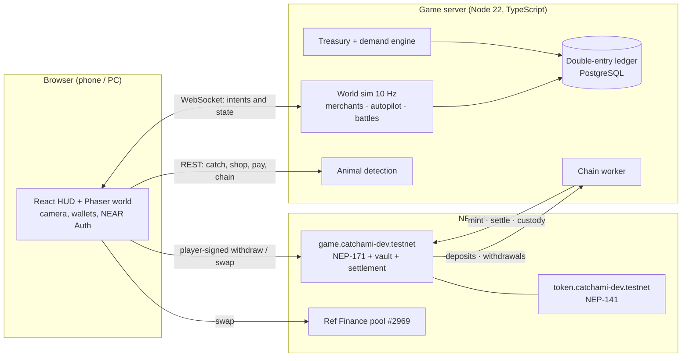

# Catchami architecture

## Repository

| Path | What |
|---|---|
| `packages/shared` | Rules shared by server, client and simulator: the versioned `ECONOMY` config, exact bigint money, fair RNG, catch/rarity/genome, combat and minigames, demand and treasury math, world map, wire protocol |
| `apps/server` | HTTP API and WebSocket gameplay, world simulation and autopilot (`world/`), ledger and treasury (`ledger/`), capture pipeline (`capture/`), chain worker, signer and NEAR Auth (`chain/`), payments (`payments.ts`), economy simulator (`sim/`) |
| `apps/web` | Vite + React HUD, Phaser world, capture screen, Coin Vault, buy/withdraw/trade sheets, marketplace, fairness verifier, `/admin` |
| `contracts/token` | $CATCHAMI NEP-141: 100T minted once to the HQ / market / team accounts, with no mint function |
| `contracts/game` | Pet and gear NFTs (NEP-171), per-bucket vault, settlement batches, withdrawals with an escape hatch, deposits, and a wallet-level marketplace |
| `trailer/` | The Remotion project for the trailer (real gameplay recordings) |

## Authority and trust

- **The browser is never trusted.** It sends intents (`move`, `goto`, `gather`, `sell`, `buy`, `talk`, `strategy`, battle actions). Positions, gather timing, minigame grading, merchant cash, prices and battle outcomes are all computed on the server.
- **One transaction per financial effect.** The ledger entry and the game state (inventory, merchant cart, HQ stock) commit together. A pet is locked while its transaction is in flight, so it can't spend twice.
- **Rules enforced by the database:**
  - `balance − held ≥ 0` is a check constraint
  - journal entries are idempotent (`UNIQUE(idem)`), immutable, and each sums to zero
  - treasury days enforce `merchant_granted ≤ merchant_allowance`
  - HQ stock can't go negative
- **Holds** reserve funds for in-flight obligations such as on-chain withdrawals.
- **Reconciliation** runs every 5 minutes:
  - the ledger sums to zero, and cached balances match postings and holds
  - no account is below zero, and claims are within the supply
  - budgets are within their caps
  - the vault's on-chain balance covers the ledger's liability

## Money flow (ledger postings)

| Event | Postings |
|---|---|
| Coin purchase or other vault deposit (indexed from the contract) | chain → user / pet / HQ |
| Successful catch | user −cost; pet +40%, HQ +50%, team +10% |
| Valid catch, failed roll | user −cost; HQ +100% |
| Invalid capture, missed throw, expiry, server error | nothing |
| Merchant trip | HQ → merchant (capped by the daily allowance and the reserve floor) |
| Sale to a merchant | merchant → pet |
| Meal / medicine / crafting | pet −price; HQ +90%, team +10% |
| Marketplace sale (5%) | buyer −price; seller +95%; HQ +2.5%, team +2.5%; the pet and its balance change owner |
| Bubble Roulette between players | loser −share (above a protected 50K); winner +90%; HQ +9%, team +1% |
| On-chain withdrawal | a hold on the source, captured when the contract executes it (source → chain) |

`chain` is the external counterpart: `−balance(chain)` is what the ledger says the vault holds.

## Treasury and demand

- **Daily merchant budget** = `min(0.01% × spendable + 60% × 7-day average HQ revenue, 0.03% × spendable)`, where spendable = HQ available − 2T floor. Below 6T, merchant prices taper linearly to zero at the floor. See `packages/shared/src/economy.ts`.
- **Demand:** consumption (meals, medicine, crafting) and supply (merchant purchases) feed rates smoothed with a 3-hour half-life. The index steps at most 2.5 points per minute toward `(consumed + 4) / (supplied + 4)`, within 60%–175%.
- **Price** = base × index × treasury factor × merchant preference.

Details: [ECONOMY.md](ECONOMY.md).

## Autopilot

`apps/server/src/world/ai.ts` runs every ~1.2 s for each pet that isn't being steered (steering pauses it for 45 s). In priority order: medicine at 0 HP → meal when hungry → medicine below 30% HP → nap when tired → gather (a chosen resource, or the highest demand) and sell (by the owner's rule). It uses only the pet's own state, public merchant positions and published demand.

## Chain integration

The **chain worker** (`apps/server/src/chain/worker.ts`) runs every 8 s:

1. **Index deposits:** reads `deposits_since(seq)` and posts `chain → account`.
2. **Index withdrawals:**
   - a new request places a hold
   - an executed one posts `account → chain`
   - a cancelled one releases the hold
3. **Mint:** every unminted pet and gear item becomes an NFT, sent to the owner's NEAR account (or held by the operator for guests).
4. **Custody:** when a guest links an account, their NFTs are transferred to it, and the account is registered on the token and USDC contracts.
5. **Settle** (every 30 s, or immediately on "Sync now"):
   - nets every unsettled journal entry per vault bucket
   - sends one `settle(batch_id, deltas, journal_hash, ack_withdrawals)`
   - entries that touch `chain` are mirrors of on-chain events and are never re-settled

**What the contract enforces on every batch:**
- deltas sum to zero (the server can't create coins)
- sequential batch IDs (no replays or gaps)
- HQ debits ≤ 20B per day, a hard cap fixed at deployment
- each pet or user debit ≤ its daily allowance (signed by the owner, or the owner-set default)
- the team bucket can never be debited by settlement

**Withdrawals:** `request_withdrawal` reserves funds. `execute_withdrawal` succeeds once the operator has acknowledged the request, or after 24 hours regardless. Pausing never blocks withdrawals.

**Wallet-level marketplace:** the game contract also has its own `list` / buy-via-`ft_transfer_call` path with a 2% fee (90% HQ / 10% team), for wallet-held NFTs. The in-game marketplace uses the ledger and the 5% fee above.

**Owner powers:** the owner (`catchami-dev.testnet`) can rotate the operator, pause, lower the HQ cap and set default allowances. It can never move anyone's balance.

## Sign-in and payments

- **Accounts:**
  - guests get HMAC-signed session tokens
  - NEAR wallets sign in with NEP-413 messages, and the server checks the key is a full-access key on-chain
  - NEAR Auth logins verify the Auth0 ID token and derive the player's implicit account from NEAR's MPC contract (`chain/nearauth.ts`)
- **Payments** (`payments.ts`):
  - quotes come from Ref pool #2969
  - delivery is a real `ft_transfer_call` from the market account
  - the card and NEAR Intents payment steps are simulated on testnet

See [WEB2_ONBOARDING_AND_PAYMENTS.md](WEB2_ONBOARDING_AND_PAYMENTS.md).

## Fair randomness

Hourly epochs. The server publishes `sha256(seed)` when an epoch starts and reveals the seed when it ends (`GET /api/fairness`). Every roll is `HMAC-SHA256(seed, label)`: catches, rarity, gear, battle chambers, spoils and minigame rounds. The Fair rolls screen recomputes catches in the browser.

## Capture pipeline

1. **Client:** the live camera with an on-device detector for the aiming reticle (display only).
2. **`POST /api/catch/validate`** with 2–3 burst frames. The server checks:
   - liveness: frames must differ slightly but match
   - detection: an on-server detector on every frame (score ≥ 0.6, same species in most frames)
   - duplicates: a perceptual-hash check over 30 days

   Only the animal crop is kept, as a sticker.
3. **`POST /api/catch/attempt`** with the tier and a client nonce. One transaction charges, splits the cost, creates the pet and its account, and queues the NFT mint.

## Scaling

Simulation shows a single world saturates with too many pets, because resource nodes regrow at a fixed rate and only four merchants serve it. The plan is world instances of about 250 pets, sharing one ledger and one treasury. The `Game` class is self-contained per world; shard routing is the outstanding piece.
