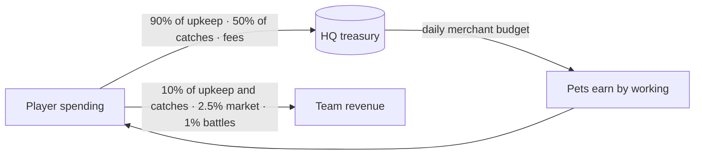

# Catchami business model

## 1. Overview

Catchami is a mobile-first game where real animals, caught with a phone camera, become playable NFT pets that hold their own coins, work, trade and look after themselves.

The business rests on one idea: **players spend because the game is fun to play and pets need care, not because spending promises a return.** Catching, collecting, feeding, healing, crafting and trading are all things players do for the game itself. Each of them carries a small, transparent fee.

## 2. Target audience

| Segment | What they want | How Catchami serves it |
|---|---|---|
| Casual mobile players and pet lovers | Something charming to play in short sessions | Catch your own cat or dog, name it, watch it live in a cozy world |
| Collectors | Rare, personal, tradable items | Every pet is unique (rarity, traits, stats, sticker from a real photo) and is an NFT |
| Strategy and idle-game players | Optimise a little economy | Demand-driven prices, merchant routes, gear, autopilot strategies |
| Web3-native players | Real ownership and withdrawal | NEP-171 pets, NEP-141 coins, withdraw to your own wallet and trade |

## 3. Value proposition

- **For players:** your actual pet becomes a game character that earns, spends and can be traded with its savings included. Onboarding feels like a normal mobile game: guest or one-tap login, coins rather than tokens, and no wallet pop-ups during play.
- **For the ecosystem:** an NFT that does something. It's a working character with a balance and a history, not just a picture.
- **For the business:** recurring, activity-driven fees instead of one-off sales, in an economy with a fixed supply and a disciplined treasury.

## 4. Acquisition and retention drivers

| Driver | Why it works |
|---|---|
| **Real-world catching** | Every cat or dog becomes a reason to open the app; catches are personal and shareable |
| **Pets with needs** | Hunger, energy and HP bring players back to feed, heal and plan |
| **Autopilot** | Pets keep working while you're away, so there's progress to check on |
| **Social play** | Bubble Roulette battles, a shared world, a marketplace, leaderboards |
| **Collection** | Six rarities, traits, gear, and holographic cards |
| **Low-friction start** | Guest access and a guaranteed first catch |

## 5. Revenue streams

All in-game fees are fixed in `packages/shared/src/config.ts` and recorded in the double-entry ledger.

| Activity | Player pays | Pet keeps | HQ (reinvested) | Team (revenue) |
|---|---|---:|---:|---:|
| Successful CamiCube catch | 1M / 3M / 8M | 40% | 50% | **10%** |
| Failed catch (a valid animal escaped) | Cube price | — | 100% | — |
| Invalid capture | Nothing | — | — | — |
| Meal | 7K (imported 14K) | — | 90% | **10%** |
| Medicine | 35K (imported 70K) | — | 90% | **10%** |
| Gear crafting (fee + any materials bought) | 40K–90K + materials | — | 90% | **10%** |
| Marketplace sale (pet or gear) | 5% of the price, from the sale | Seller gets 95% | 2.5% of price | **2.5% of price** |
| Bubble Roulette, player vs player | 10% of the coins the winner takes | Winner gets 90% | 9% of coins taken | **1% of coins taken** |
| Coin purchase from the market allocation | Price of the pouch / purchase | — | — | Primary sale proceeds (see below) |

There are two different kinds of revenue here:

1. **Recurring in-game fees.** The team column above is paid in $CATCHAMI as players play. It's coin-denominated revenue.
2. **Primary distribution.** When players buy coins from the 55T market allocation, they pay in fiat or crypto. This is the external revenue. On the current test network, the card and crypto payment steps are simulated; the coin delivery itself is a real on-chain transfer.

The team's **5T token allocation** is a founding allocation. It isn't revenue and isn't counted in the fees above.

## 6. Revenue allocation

## 7. HQ reinvestment

HQ is not a profit account. It's the engine that pays players for work. Its daily budget is set by its reserve and the last 7 days of revenue (see [ECONOMY.md §9](ECONOMY.md#9-the-dynamic-treasury-formula)). When players spend more, HQ can fund more merchant purchases. The 2T floor and the on-chain 20B/day cap keep it from overspending.

## 8. Creator and team revenue

The team earns a share of activity, not of balances:
- **Catches and upkeep:** 10% of every successful catch and of all meals, medicine and crafting.
- **Marketplace:** a 2.5% royalty on every pet and gear sale.
- **Battles:** 1% of coins transferred in player-vs-player Bubble Roulette.

Example from the game: one fed pet eats about 14 meals a day (≈ 96K), which sends about 9.6K a day to the team from meals alone.

## 9. Why spending recurs

- **Needs:** pets get hungry every 5 hours, and battles cost HP. Care is a daily need, not a one-off.
- **Progress:** gear makes pets faster and stronger, which matters for gathering and battles.
- **Collection:** new animals mean new catches, and rarer cubes improve the odds.
- **Trading:** good pets, with their balances, are worth selling and buying.

## 10. Player incentives

- **Work earns:** pets earn by selling resources at demand-driven prices. Skill (perfect minigame taps), merchant choice and strategy all matter.
- **Ownership:** a pet's savings stay with the pet, and the owner can withdraw them to their own wallet.
- **Fair rolls:** every random outcome uses a commit-reveal seed that players can check.

Earnings depend on play and on other players. The game doesn't promise a return.

## 11. Illustrative fee scenario

*Illustrative only. These are assumptions, not forecasts.* Suppose 1,000 active pets, each eating 14 meals a day, plus 50 basic catches a day:

| Item | Per day | Team share |
|---|---:|---:|
| Meals: 1,000 × 14 × 7K = 98M | 98M coins | 9.8M coins |
| Catches: 50 × 1M (≈ 60% succeed → 30M in successful catches) | 30M coins | 3M coins |
| **Total team fees** | | **≈ 12.8M coins / day** |

These are **coins**, not dollars. What they are worth depends on the market price of $CATCHAMI. For comparison, the 1,000-pet sharded simulation ([ECONOMY_SIMULATION.md](ECONOMY_SIMULATION.md)) produced 856M coins of team fees over 30 days, about 28.5M a day, for a population that grew to about 2,000 pets.

## 12. Supporting content and operations

The model funds the game in two ways:
- **HQ** recirculates player spending back into player earnings, so rewards don't need new coins.
- **The team share and primary sales** fund development, art, servers, new animals and areas, events and seasonal content.

Future sinks fit the same model: cosmetics, homes and bag upgrades (wood and stone), pet training, seasonal events, and an optional pass.

## 13. Scalability

- **Worlds of about 250 pets.** The simulation shows that keeping each world around 250 pets keeps over 90% of pets active. Worlds share one ledger and one treasury.
- **Budget headroom.** The treasury budget isn't the bottleneck at 10,000 simulated pets: the busiest day used 1.83B of a 3.8B budget.
- **No per-action chain transactions.** Gameplay is settled in batches, so costs don't grow with every gather or sale.

## 14. Long-term direction

1. **Mainnet:** real card on-ramp, crypto payments through NEAR Intents, a real liquidity pool, audited contracts and reproducible builds.
2. **More ways in:** NEAR Auth Google, email and passkey login on the public domain, plus Solana and EVM wallet sign-in.
3. **More world:** more species, areas, merchants and seasonal events.
4. **Deeper ownership:** on-chain listing for wallet-held pets, and detection of NFT transfers made outside the game.
