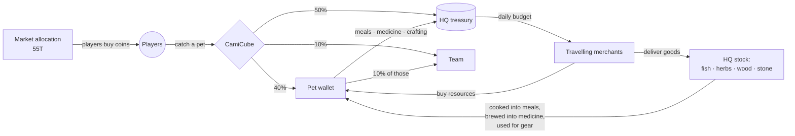
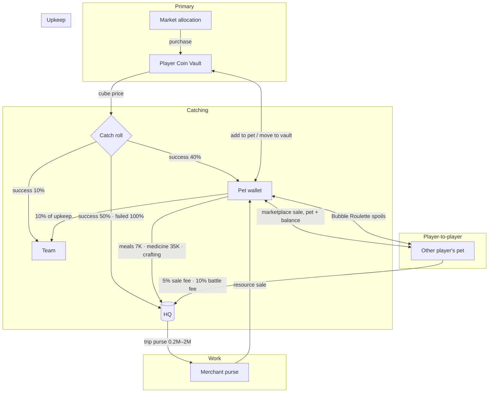

# The Catchami economy

Catchami runs a closed, circulating token economy. Players buy coins, spend them catching and caring for pets, and those pets earn coins back by working. In the middle sits **HQ**, a treasury that collects a share of what players spend and uses it to fund the travelling merchants who buy the pets' work.

This document explains every coin flow, the formulas behind them, and what the design does and does not guarantee.

> **Source of truth.** Every number here comes from `packages/shared/src/config.ts` (economy config `2026-11-14.1`) or the code that uses it. Amounts are in whole $CATCHAMI ("coins"): 1K = 1,000 and 1M = 1,000,000.

---

## 1. Overview in one picture



The loop in plain words:

1. Players get $CATCHAMI (bought from the market allocation).
2. They spend it on CamiCubes to catch pets. The pet keeps 40% as a starting purse; HQ and the team receive the rest.
3. HQ funds travelling merchants every day, within a budget set by its reserves and recent revenue.
4. Pets gather resources and sell them to merchants. The coins land in the **pet's own wallet**.
5. Pets spend coins on meals, medicine and gear. 90% returns to HQ, 10% goes to the team.
6. The goods merchants bought become HQ's stock, which is what meals, medicine and gear are made from.
7. What pets eat and use changes resource demand, which changes what merchants pay. The cycle repeats.

Player-to-player activity (marketplace sales, battle spoils) moves existing coins between players and needs no HQ funding at all.

---

## 2. $CATCHAMI tokenomics

| Allocation | Amount | Holder (NEAR testnet) | Purpose |
|---|---:|---|---|
| HQ treasury | **40T (40%)** | Deposited into the game vault as the HQ bucket | Funds merchant purchases; refilled by player spending |
| Market | **55T (55%)** | `market.catchami-dev.testnet` | Coins sold to players, and liquidity for trading |
| Team | **5T (5%)** | `team.catchami-dev.testnet` | Founding/team allocation |
| **Total** | **100T** | `token.catchami-dev.testnet` (NEP-141, 18 decimals) | Minted once at deployment |

- **Fixed supply.** The token contract mints all 100T once in its constructor and has no mint function. This was verified on-chain: deployment transaction `AoueLQ86LoFDwNfi1nsyYn1ruNf6Ef155ZzJ93HFTL2K` logs the three mints.
- **The HQ allocation is a coin reserve, not cash.** It's 40T of the game's own token, used to pay merchants. It's not a fiat or stablecoin treasury.
- **The team allocation is separate from gameplay revenue.** The 5T is an allocation; the team's gameplay fees (§11) are earned on top of it.

---

## 3. Complete money flow



---

## 4. Catching economics

A catch needs a **real cat or dog** in front of the camera. The server checks a live burst of 2–3 frames (animal detector score ≥ 0.6, frames that differ slightly so a still photo fails, and a perceptual-hash duplicate check) **before** anything is charged.

| CamiCube | Cost | Catch chance | Average spend per pet |
|---|---:|---:|---:|
| Basic | 1M | 60% | ≈ 1.27M |
| Enhanced | 3M | 80% | ≈ 2.55M |
| Premium | 8M | 100% | 4.8M |

*Average spend counts failed throws and subtracts the 40% that stays in the pet.*

| Outcome | Pet wallet | HQ | Team |
|---|---:|---:|---:|
| Success | **40%** | **50%** | **10%** |
| Failed (a valid animal escaped) | — | 100% | — |
| Invalid capture (no animal, a still photo, a duplicate, an expired capture, a missed throw) | **nothing charged** | | |

- **Limits:** a player's first catch is guaranteed to succeed (rarity is still a fair roll), and there are 30 catches per player per day.
- **Rarity** (common → mythic) adds a small stat budget (+0% to +5%). That's deliberately smaller than the ±4% natural variation per stat, so rarity is mostly collectible value.
- **Demo odds:** the current rarity odds are generous (a basic cube rolls mythic 5% of the time) and are intended to be tightened before a public mainnet launch.

---

## 5. The gathering economy

Gathering is how pets earn. It has real operating costs.

| Resource | Base price per unit | Weight | Energy per unit | Hunger per unit | Value per bag slot | Minigame |
|---|---:|---:|---:|---:|---:|---|
| Herbs | 50 | 1 | 1.5 | 0.75 | 50 | Pull |
| Fish | 100 | 2 | 3 | 1.5 | 50 | Fishing |
| Wood | 150 | 3 | 4.5 | 2.25 | 50 | Chop |
| Stone | 200 | 4 | 6 | 3 | 50 | Mine |

- **Yield:** each successful hit gives 10 units; a perfect minigame tap gives 20. Every attempt costs 3 energy.
- **Equal value per slot:** every resource is worth the same per bag slot and costs the same per slot, so there's no single best grind. Pets choose by demand, nearby merchant, species and traits.
- **Bag size:** cat 560 weight, dog 660. A full bag is worth about **28K (cat) / 33K (dog)** at normal demand.
- **Operating costs:**
  - Filling a bag costs about 840–990 energy and 420–495 hunger.
  - Energy refills for free while resting (about 28 minutes from empty), or faster with a meal (+220 energy).
  - Hunger rises from full to starving in 5 hours, so an idle pet needs about 14 meals a day (≈ 96K).
- **Real limits:** resource spots hold 100K–500K units and regrow, so in practice the binding limits are bag space, energy, hunger and merchant carts.

This is the key design choice: **earning has a running cost**. A pet that works hard eats more, and a pet that stops eating stops working.

---

## 6. Resource demand

Prices respond to recorded activity. Each resource has a demand index:

```
target  = (consumption rate + 4) / (supply rate + 4)
rates   = exponentially smoothed, 3-hour half-life
index   = moves toward target by at most 2.5 percentage points per minute
range   = 60% … 175%
```

- **Consumption** is what's actually used up: fish for meals, herbs for medicine, wood and stone for crafting.
- **Supply** is what players sell to merchants.
- The **+4** keeps a handful of events from swinging the price.

**Example.** Over the last few hours, fish consumption has averaged 20 units/h and fish sales 10 units/h:
- target = (20 + 4) / (10 + 4) ≈ **171%**
- from 100%, the index climbs 2.5 points a minute, reaching about 171% in roughly half an hour
- fishing now pays up to 1.71× base, which pulls pets toward fishing, which raises supply and lets the index settle back down

The live demand indicators in the game HUD (▲ / ▼ per resource) show this same index.

---

## 7. Merchant economics

Four travelling merchants walk fixed routes between HQ and the resource areas, each with real coins.

| Merchant | Pays more for | Pays less for |
|---|---|---|
| Finn the Fishmonger | Fish +12% | Wood −6% |
| Sage Marigold | Herbs +12% | Stone −6% |
| Timber Tom | Wood +12% | Fish −6% |
| Rocky Ruby | Stone +12% | Herbs −6% |

- **Price paid** = base price × demand index × merchant taste × treasury factor.
- **Purse:** at HQ, each merchant is funded with **0.2M–2M per trip**, taken from that day's budget. The money is real: the ledger moves coins `HQ → merchant`.
- **Cart:** up to **4,000 weight**. A full cart sends the merchant home.
- **Going home:** a merchant also returns when cash falls below 8% of the minimum purse. At HQ they unload, and the goods become **HQ stock**.
- **No budget, no trip:** if the day's budget can't cover a trip, the merchant sits out. **Merchants cannot buy without coins, cannot exceed their cart, and cannot be funded beyond the daily budget.**

The database enforces these limits, not just the game code. For example, a treasury day has `CHECK (merchant_granted <= merchant_allowance)`, so an over-budget grant fails instead of going through.

---

## 8. Consumption closes the loop

| Item | Price | Effect | Uses from HQ stock | If out of stock |
|---|---:|---|---|---|
| Meal | 7K | −350 hunger, +220 energy | 10 fish | Imported meal, 14K (2×) |
| Medicine | 35K | Heals 40% of max HP; revives a 0-HP pet | 20 herbs | Imported medicine, 70K (2×) |
| Crafting | 40K–90K fee | Gear (+3% to +11% stats) | Wood + stone (from the bag; missing materials bought from HQ at 125%) | Not craftable without stock |

- **Physical stock:** meals are cooked from fish that merchants actually delivered. Medicine is brewed from delivered herbs.
- **Imported goods:** an empty kitchen means imported goods at twice the price. Pets never get stuck, and the price premium signals demand.
- **Upkeep is the largest recurring sink.** In the current simulation, pets buy about 14 meals a day (≈ 96K–99K) against a median working income of about 110K, so upkeep absorbs most of what a pet earns. Net growth comes from good play: perfect minigame taps, picking the best-paying merchant and following demand.

---

## 9. The dynamic treasury formula

HQ sets a merchant budget each UTC day (`packages/shared/src/economy.ts → dailyBudget`):

```
Spendable    = HQ available − protected reserve (5% of 40T = 2T)

Daily budget = min( 0.01% × Spendable + 60% × 7-day average daily HQ revenue ,
                    0.03% × Spendable )
```

- **Revenue** counts only coins players actually spent into HQ: its share of catches (including failed catches), meals, medicine, crafting, and marketplace and battle fees. Deposits, merchant returns and genesis funds don't count, so the budget can't be inflated by moving coins around.
- **Today** (about 38T spendable): the base budget is about **3.8B/day** and the cap is **11.4B/day**. The live server reported a next-day budget of 3.80B with a 7-day revenue average of about 0.39M/day (2026-11-15).
- **Near the floor:**
  - when HQ falls below 6T (3× the reserve), merchant prices taper linearly toward zero
  - the budget can never take HQ below the 2T reserve
- **On-chain hard cap:** separately, the game contract refuses to let settlement debit HQ by more than **20B per day**. That cap is fixed at deployment; the owner can only lower it, never raise it.

### Authorized budget vs actual spending

The budget is a **ceiling**, not a payout. What merchants actually spend is limited by real activity: how many pets sell, cart space, and how far merchants walk. In the 10,000-pet simulation, the busiest day used **1.83B of a 3.80B budget**.

---

## 10. Sustainability model

The economy is built to stay solvent and responsive. Here's what does that:

| Mechanism | Effect |
|---|---|
| Fixed 100T supply | No coins are created to fund rewards |
| Finite HQ reserve with a 2T floor | Merchant spending is bounded and can't drain the treasury |
| Spending recycled into HQ | Catches, upkeep, crafting and fees refill the reserve that pays merchants |
| Revenue-linked budget | More player spending allows a bigger merchant budget; less spending shrinks it |
| Demand-driven prices | Over-supplied resources pay less, scarce ones pay more |
| Physical merchant limits | Carts, purses and routes cap how fast coins can leave HQ |
| Upkeep costs | Working pets consume, which creates real demand |
| Player-to-player trade | Marketplace and battles circulate coins without HQ |

**What this achieves:** treasury discipline (HQ cannot overspend), rewards tied to real activity and real consumption, and an economy whose payouts adapt as participation changes.

**What it does not guarantee:**
- **Profit:** a circulating economy does not by itself guarantee every player profits. Earnings depend on how well a pet is managed, and on what other players do.
- **Price:** a fixed supply does not guarantee a stable or rising token price. The market price of $CATCHAMI depends on real demand and liquidity.
- **External revenue:** recycled coins are not new money. External revenue only comes from people paying for coins or services.

---

## 11. Revenue versus token recycling

These are different things and are kept apart in the ledger:

| Category | What it is | Example |
|---|---|---|
| **HQ token receipts** | Coins players spend that return to HQ | 6,300 of a 7,000 meal |
| **HQ token expenditures** | Coins HQ pays out through merchants | A merchant buying a bag of fish |
| **Team token fees** | The team's share of gameplay spending, in coins | 700 of a 7,000 meal |
| **Primary distribution proceeds** | What buyers pay for coins from the market allocation | A player buying a pouch |
| **External payment revenue** | Fiat or crypto actually received | Card or crypto payments (simulated on testnet) |
| **DEX liquidity and market value** | Coins trading against USDC on a pool | Ref Finance pool #2969 on testnet |

**Accounting example (one day, one pet):**
- The pet sells fish to a merchant for **31,360**. HQ's merchant budget pays this.
- It buys two meals: **14,000** spent. HQ receives 12,600 and the team 1,400.
- **Net for HQ:** −31,360 + 12,600 = **−18,760** coins. The pet nets +17,360.

That's normal and intended: HQ's 40T reserve exists to pay for work. Across the whole game, HQ is replenished by catches, upkeep, crafting and fees from all pets. In every simulated scenario, HQ ended the 30 days slightly **above** where it started (§13).

None of the coin flows above are fiat revenue. Fiat or crypto revenue arises only when players pay for coins (primary distribution) or other paid services. See [BUSINESS_MODEL.md](BUSINESS_MODEL.md).

---

## 12. Worked example: one pet, one cycle

| Step | Coins | Detail |
|---|---:|---|
| 1. Basic catch succeeds | −1,000,000 player | Pet wallet +400,000 · HQ +500,000 · Team +100,000 |
| 2. A cat fills its bag with fish | — | 560 weight ÷ 2 = 280 fish; costs 840 energy, 420 hunger |
| 3. Sells to Finn at 100% demand (+12% fish preference) | +31,360 pet | 280 × 112. Paid from Finn's HQ-funded purse |
| 4. Finn returns to HQ | — | 280 fish join HQ stock (enough for 28 meals) |
| 5. Pet buys a meal | −7,000 pet | HQ +6,300 · Team +700 · HQ stock −10 fish |
| 6. Demand updates | — | Each meal records 10 fish consumed; each sale records supply. The fish index moves toward the new ratio |
| 7. Next day's budget | — | HQ's revenue (catch share + meals) feeds the 60% revenue term of tomorrow's merchant budget |

The pet ends the cycle with 400,000 + 31,360 − 7,000 = **424,360** coins, and the rest of its hunger is covered by resting or a second meal.

---

## 13. Sustainability scenarios (simulation evidence)

`pnpm sim` runs a 30-day agent-based model on the live config, with an exact double-entry ledger and daily invariant checks. The population is a mix of casual players, grinders, big spenders, bot-like farmers and dormant owners. Figures are **simulated**, not real users. Full tables: [ECONOMY_SIMULATION.md](ECONOMY_SIMULATION.md).

| Scenario (30 days) | Pets at end | Active pets | HQ change | Merchant spend (30 days) | Busiest day vs budget | Median pet balance |
|---|---:|---:|---:|---:|---:|---:|
| 100 pets, one world | 236 | 100% | +0.27B | 0.62B | 25M / 3.8B | 1.0M |
| 1,000 pets, one crowded world | 2,029 | 32.6% | +4.28B | 1.20B | 42M / 3.8B | 5K |
| 1,000 pets, 250 per world | 2,048 | 97.9% | +2.32B | 5.09B | 225M / 3.8B | 826K |
| 10,000 pets, 250 per world | 17,908 | 92.2% | +21.6B | 43.6B | 1.83B / 3.8B | 731K |
| 10,000 pets, falling token price + fewer signups | 11,191 | 87.4% | +14.8B | 31.7B | 1.12B / 3.8B | 517K |

How to read it:
- **Healthy activity (250 pets per world):** about 92–98% of pets stay active, the median working pet earns about 110K a day, and HQ ends slightly up.
- **Slower activity / fewer token purchases:** with a falling price and declining signups, 87% of pets stay active, merchant spending drops by about a quarter, and HQ still ends up.
- **Crowded world:** 1,000 pets sharing one map's resource nodes is the stress case. Two-thirds go inactive, because four merchants and fixed nodes can't serve that many pets. The conclusion is to keep worlds around 250 pets (or add merchants), which is the planned sharding model.
- **Higher population:** at 10,000 pets (about 17,900 by day 30) the budget is still not the binding constraint: the busiest day used 1.83B of 3.8B. Beyond that, the budget formula becomes the safety valve that caps payouts.
- **No new players:** dormant pets keep running on autopilot; pets that can't afford food go inactive until their owner adds coins.
- **Smaller HQ reserve:** below 6T, prices taper, and the budget can never cross the 2T floor. This wasn't triggered in 30 days at any population tested.

**Invariants:** 0 violations across all five scenarios.

---

## 14. Financial safeguards

| Safeguard | Where | What it prevents |
|---|---|---|
| Fixed supply, no mint function | Token contract | New coins appearing |
| Double-entry ledger (every entry sums to zero) | Server database | Coins created or lost in bookkeeping |
| Idempotent journal entries (unique key) | Server database | Double payments on retries |
| `balance − held ≥ 0` check constraint | Server database | Any account going negative |
| Daily merchant allowance check | Server database | Merchants funded beyond the day's budget |
| Reserved withdrawals (holds) | Server + contract | Spending coins that are being withdrawn |
| 2T treasury floor | Treasury code | HQ draining below its reserve |
| Balanced, sequenced settlement batches | Game contract | The server minting coins on-chain, or replaying a batch |
| 20B/day HQ hard cap; per-pet daily allowances; team bucket undebitable | Game contract | A compromised server emptying HQ or a pet |
| 24-hour withdrawal escape hatch | Game contract | A server that refuses to process withdrawals |
| Reconciliation every 5 minutes | Server | Ledger and on-chain vault drifting apart |

See [ONCHAIN_VERIFICATION.md](ONCHAIN_VERIFICATION.md) for how to check the on-chain parts yourself, and [ARCHITECTURE.md](ARCHITECTURE.md) for the implementation.

---

## Known boundaries

- **Battle stakes:** Bubble Roulette between players moves a share of the loser's coins (above a protected 50K). That's live on the test network. Real-value stakes need legal review before mainnet. The config reserves a disabled `realTokenPvp` switch for this, but it isn't yet enforced in battle settlement.
- **Simulation scope:** the model's player mix is an assumption, and token price effects are modelled only in the falling-price scenario.
- **Demo odds:** rarity odds are generous for the demo and will be tightened before a public mainnet launch.
