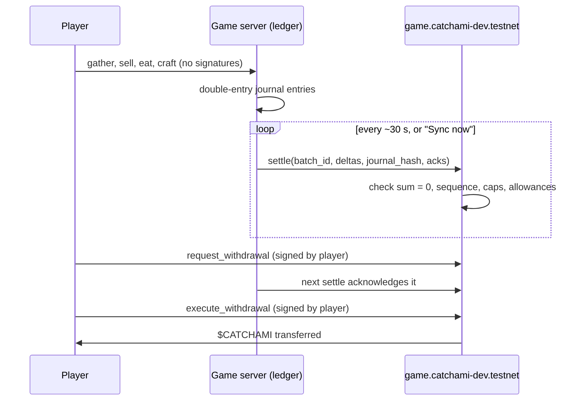

# On-chain verification guide

Everything below is on **NEAR testnet**, and every transaction hash was checked on 2026-11-15 with the testnet archival RPC (`EXPERIMENTAL_tx_status`): each one succeeded. Testnet tokens have no monetary value.

Explorers: [testnet.nearblocks.io](https://testnet.nearblocks.io) or [testnet.near.rocks](https://testnet.near.rocks). Replace the hash or account in the URLs below.

## Contracts and accounts

| What | Account | Standard |
|---|---|---|
| $CATCHAMI token | [`token.catchami-dev.testnet`](https://testnet.nearblocks.io/address/token.catchami-dev.testnet) | NEP-141, 18 decimals, 100T fixed supply |
| Game contract: pet and gear NFTs, vault, settlement, withdrawals | [`game.catchami-dev.testnet`](https://testnet.nearblocks.io/address/game.catchami-dev.testnet) | NEP-171 (+ metadata, enumeration) |
| Operator (game server signer) | `operator.catchami-dev.testnet` | — |
| Owner (pause, rotate operator, lower caps) | `catchami-dev.testnet` | — |
| Allocations | `hq.` / `market.` / `team.catchami-dev.testnet` | — |
| Trading pool | `ref-finance-101.testnet`, pool **#2969** ($CATCHAMI / `usdc.fakes.testnet`, 0.3% fee) | Ref Finance |

## Verified transactions

| Event | Transaction | Signer → receiver |
|---|---|---|
| Token deployed; 100T minted to HQ (40T), market (55T) and team (5T) | [`AoueLQ86LoFDwNfi1nsyYn1ruNf6Ef155ZzJ93HFTL2K`](https://testnet.near.rocks/tx/AoueLQ86LoFDwNfi1nsyYn1ruNf6Ef155ZzJ93HFTL2K) | `token.catchami-dev.testnet` |
| Game contract deployed and initialised (HQ hard cap 20B/day) | [`485GnhunN7Eb3MQT5wMFRpyyLSMETUEBbgUuCocyh5wd`](https://testnet.near.rocks/tx/485GnhunN7Eb3MQT5wMFRpyyLSMETUEBbgUuCocyh5wd) | `game.catchami-dev.testnet` |
| HQ's 40T deposited into the vault (`deposit_hq`) | [`2shFEofYXWi6c9ptRXq1H4LyfDVuZb8Qnf2nuNZcLGgQ`](https://testnet.near.rocks/tx/2shFEofYXWi6c9ptRXq1H4LyfDVuZb8Qnf2nuNZcLGgQ) | `hq.` → token |
| Liquidity added to Ref pool #2969 (300B $CATCHAMI + 100,000 test USDC) | [`8c5t2tMJS8nLh1j1uhryMdx3jifergAtNMRF4TiUDs6H`](https://testnet.near.rocks/tx/8c5t2tMJS8nLh1j1uhryMdx3jifergAtNMRF4TiUDs6H) | `market.` → `ref-finance-101.testnet` |
| A player's starter pouch delivered (25M, `deposit_for`) | [`GnGiaai4oAQLGjVrxJXr5B2spea433H8W9wftHF1Tsgs`](https://testnet.near.rocks/tx/GnGiaai4oAQLGjVrxJXr5B2spea433H8W9wftHF1Tsgs) | `market.` → token |
| First settlement batch (#0) | [`6Ky3bCZEfCPQfTk51W85n4wsfENYwnqm1u5ejHZaNfRJ`](https://testnet.near.rocks/tx/6Ky3bCZEfCPQfTk51W85n4wsfENYwnqm1u5ejHZaNfRJ) | `operator.` → game |
| Pet NFT minted: **Pudding**, a mythic cat caught from a real photo (`a-pet_t7AnQPecSY1S`) | [`Er6WcvCUbjDcE2YdyPwczMkFM5ijE6nKo5YrdwxZ4yRm`](https://testnet.near.rocks/tx/Er6WcvCUbjDcE2YdyPwczMkFM5ijE6nKo5YrdwxZ4yRm) | `operator.` → game |
| Settlement batch #16: HQ +63K, Pudding −70K, Team +7K (an imported medicine bought by Pudding) | [`AW9Mcjtm8tywTFxErj97dJ9EN2wVqZFYJQeBBRwNQc4p`](https://testnet.near.rocks/tx/AW9Mcjtm8tywTFxErj97dJ9EN2wVqZFYJQeBBRwNQc4p) | `operator.` → game |
| Player requests a withdrawal from their pet (2M) | [`EJojzwE82QKwWgBKnECqsy6wbSfo2HZiV5htGDWKSapL`](https://testnet.near.rocks/tx/EJojzwE82QKwWgBKnECqsy6wbSfo2HZiV5htGDWKSapL) | `catchami-ops.testnet` → game |
| Player executes the withdrawal (2M arrives in their wallet) | [`GvQvPnwzqeLF9FRSMy3Bp1vTomjYneusEVkeBqieiWm`](https://testnet.near.rocks/tx/GvQvPnwzqeLF9FRSMy3Bp1vTomjYneusEVkeBqieiWm) | `catchami-ops.testnet` → game |
| Player swaps 2M $CATCHAMI for ≈ 0.66 test USDC | [`7hun1CDvwEmbAUQBcn1JA8n6tamPSAptB12peSBcLMmv`](https://testnet.near.rocks/tx/7hun1CDvwEmbAUQBcn1JA8n6tamPSAptB12peSBcLMmv) | `catchami-ops.testnet` → token → Ref |

`catchami-ops.testnet` is a test account used to play as a real player, signing with its own key.

## Read it yourself

All of these are free, read-only calls. With [near-cli-rs](https://github.com/near/near-cli-rs):

```bash
# Total supply: 100,000,000,000,000 × 10^18
near contract call-function as-read-only token.catchami-dev.testnet ft_total_supply json-args '{}' network-config testnet now

# Pudding's NFT: owner and metadata
near contract call-function as-read-only game.catchami-dev.testnet nft_token json-args '{"token_id":"a-pet_t7AnQPecSY1S"}' network-config testnet now

# Pudding's own coin balance in the vault (its piggy bank)
near contract call-function as-read-only game.catchami-dev.testnet balance_of json-args '{"bucket":{"Pet":"a-pet_t7AnQPecSY1S"}}' network-config testnet now

# HQ's bucket, and the contract's rules (hard cap, next batch number, allowances)
near contract call-function as-read-only game.catchami-dev.testnet balance_of json-args '{"bucket":"Hq"}' network-config testnet now
near contract call-function as-read-only game.catchami-dev.testnet config json-args '{}' network-config testnet now

# Live pool price: $CATCHAMI received for 1 test USDC
near contract call-function as-read-only ref-finance-101.testnet get_return json-args '{"pool_id":2969,"token_in":"usdc.fakes.testnet","amount_in":"1000000","token_out":"token.catchami-dev.testnet"}' network-config testnet now
```

The game server publishes the same view over HTTP:
- `GET https://catchami.fun/api/chain` shows the pool reserves, the latest settlement batch and its transaction hash.
- `GET https://catchami.fun/api/economy` shows the HQ balance, the reserve floor and today's merchant budget.

## What each piece proves

| Claim | How to check |
|---|---|
| Supply is fixed | The token contract has no mint function; `ft_total_supply` = 100T |
| Each pet is an NFT | `nft_token` returns the owner and metadata (name, rarity, species, sticker URL) |
| Each pet has its own wallet | `balance_of({"Pet": tokenId})` returns that pet's balance, reserved and available amounts |
| Gameplay settles on-chain | `settle` transactions list per-bucket deltas that sum to zero, plus a journal hash and a sequential batch number |
| The server can't mint coins | `settle` rejects any batch that doesn't sum to zero, or that skips or replays a batch number |
| HQ spending is capped | `config.hq_daily_hard_cap` = 20B/day, fixed at deployment |
| Players can always exit | `request_withdrawal` reserves funds; `execute_withdrawal` works once acknowledged, or after 24 hours regardless |
| Trading is real | The swap transaction routes through Ref Finance pool #2969 |

## How settlement works


