# Web2 onboarding and payments

Catchami is meant to feel like a normal mobile game: open it, tap once, catch your pet, play. Ownership, wallets and settlement happen underneath, and players meet them only when they choose to, for example when withdrawing coins to their own wallet.

## The player journey

```mermaid
flowchart LR
    A[Open catchami.fun] --> B[Guest · Google · NEAR wallet]
    B --> C[Get a starter pouch<br/>or buy coins]
    C --> D[Catch a real cat or dog]
    D --> E[Pet NFT with its own wallet]
    E --> F[Pet works and earns]
    F --> G[Withdraw from the pet<br/>to your wallet]
    G --> H[Swap $CATCHAMI for USDC]
    H --> I[Cash out to a bank<br/>via an off-ramp provider]
```

| Step | What the player sees | What happens underneath | Test network status |
|---|---|---|---|
| Sign in | One tap | A game account; optionally a NEAR account | Live (details below) |
| Get coins | A pouch or "Buy" screen | The market account sends $CATCHAMI into the game vault for the player | Delivery live; payment simulated |
| Catch | Camera, cube, "Caught!" card | Server checks the animal, rolls fairly, mints a NEP-171 NFT | Live |
| Play | Coins go up and down | Double-entry ledger; net changes settled on NEAR every ~30 s | Live |
| Withdraw | "Withdraw to my wallet" | Player-signed `request_withdrawal` and `execute_withdrawal` | Live |
| Swap | "Sell for USDC" | Player-signed swap on Ref Finance pool #2969 | Live (test USDC) |
| Cash out | "Cash out" | USDC to fiat through a compliant off-ramp | Simulated |

## Signing in

| Option | Experience | NFTs go to | Status on catchami.fun |
|---|---|---|---|
| **Play as guest** | Instant. No email, no personal data | Held by the game (custody) until a NEAR account is linked | ✅ Live |
| **Continue with Google** | One tap | Held by the game until a NEAR account is linked | ✅ Live as a simulated sign-in: it creates a game account without a Google check |
| **NEAR Auth (Google, email, passkey)** | Google, email or passkey that controls a real NEAR account, with no seed phrase | Straight into the player's own NEAR account | ✅ Implemented. Works on origins NEAR has approved; `catchami.fun` is awaiting approval |
| **NEAR wallet** (Meteor, Intear, HERE, Sender) | The wallet signs a message (NEP-413), with no gas | Straight into the wallet | ✅ Live |
| Solana / EVM wallets | "Coming soon" | — | Planned |

### How NEAR Auth works

1. The player signs in with Google, email or passkey in NEAR Auth's login window.
2. The server verifies the ID token against the issuer's published keys.
3. NEAR's MPC signer network derives the player's key, and the player's account is the **implicit NEAR account** of that key. The same login always gives the same account.
4. On testnet, the game sends the new account 0.05 NEAR so it exists and can pay its own gas.
5. To withdraw or swap, the player approves the exact transaction in the NEAR Auth window. The server relays the signing request (and pays its gas), and the browser broadcasts the signed transaction from the player's own account.

NEAR's shared testnet login only returns to `http://localhost:3000`. Running Google sign-in on `catchami.fun` needs NEAR to approve the domain or issue a dedicated client ID. Until then, the public site uses the simulated one-tap sign-in above, and real NEAR Auth can be demonstrated locally with `pnpm --filter @catchami/web dev:nearauth:live`.

### Linking later

A guest can connect a NEAR wallet at any time from **Coin Vault → Withdraw → Connect**. When they do, three things happen automatically:
- Their custody NFTs transfer to the new account.
- Their on-chain Coin Vault balance moves from the guest bucket to the new account.
- The game registers the account on the $CATCHAMI and USDC token contracts, so it can receive withdrawals and swaps.

## Getting coins

### Starter pouch (once per account)

| Pouch | Coins | Shown price |
|---|---:|---:|
| Sprout Pouch | 10M | 1 NEAR |
| Bloom Bag | 25M | 2 NEAR |
| Grove Chest | 60M | 4 NEAR |

On the test network, no NEAR is charged. The coins are **real testnet $CATCHAMI**, delivered from the market allocation by an on-chain `ft_transfer_call`.

### Buy screen (Coin Vault → Buy)

- **Amount:** $1–$500 per purchase, up to $2,000 per player per day on the test network.
- **Card:** a 3.5% fee is shown. On testnet the checkout is simulated and no card details are collected.
- **Any crypto (NEAR Intents):** more than 100 assets with live USD prices from the NEAR Intents 1Click token list, with about a 0.1% fee. NEAR Intents runs only on mainnet, so the payment step is simulated on testnet.
- **Price:** quoted live from the $CATCHAMI/USDC pool on Ref Finance.
- **Delivery:** a real on-chain transfer from the market allocation into the player's vault bucket. The player sees an explorer link.

## Owning and moving coins

| Place | What it is | On-chain |
|---|---|---|
| **Coin Vault** | The player's coin balance | Vault bucket `User(<NEAR account>)`, or a guest bucket |
| **Piggy bank** | A pet's own balance | Vault bucket `Pet(a-<petId>)` |
| **Your wallet** | The player's NEAR account | Regular $CATCHAMI balance on the token contract |

- **Add to pet / Move to Coin Vault:** instant, inside the game.
- **Withdraw to my wallet:** the player signs `request_withdrawal`, the game acknowledges it in the next settlement batch, then the player signs `execute_withdrawal` and the coins arrive. If the game never acknowledges, the player can execute after 24 hours anyway.
- **Pet sold:** the piggy bank goes with the pet NFT.

## Gas and signing

| Action | Who signs | Who pays gas |
|---|---|---|
| Gathering, selling, buying meals, crafting, battles | Nobody (server-authoritative gameplay) | — |
| Minting pet NFTs, custody transfers, settlement batches | The game's operator account | The game |
| Token registration for new accounts | The game | The game |
| Coin delivery after a purchase | The market account | The game |
| Withdrawing from a pet | The player (2 transactions) | The player (tiny testnet amounts; NEAR Auth accounts are pre-funded on testnet) |
| Swapping to USDC | The player | The player |

Because everyday play never asks for a signature, the game feels like a regular mobile game. Players sign only when they move value out.

## Swap and off-ramp

- **Swap (live on testnet):** Coin Vault → Trade → **Sell for USDC**. A live quote comes from Ref Finance pool #2969. The player's wallet signs a swap with 1% maximum slippage, and test USDC (`usdc.fakes.testnet`) arrives in their account. A real swap is recorded in [ONCHAIN_VERIFICATION.md](ONCHAIN_VERIFICATION.md).
- **Off-ramp (planned):** USDC is converted to fiat and paid to a bank account by a licensed off-ramp provider. On testnet, the Cash out tab is a simulated flow that collects no bank details and moves no funds.

## What changes for mainnet

| Piece | Mainnet requirement |
|---|---|
| Card purchases | A licensed card on-ramp provider |
| Crypto purchases | NEAR Intents on mainnet |
| Trading | A $CATCHAMI/USDC pool with real liquidity |
| Cash out | A licensed off-ramp provider |
| Google / email / passkey | A NEAR Auth client approved for the public domain |
| Contracts | An independent audit and reproducible builds |
